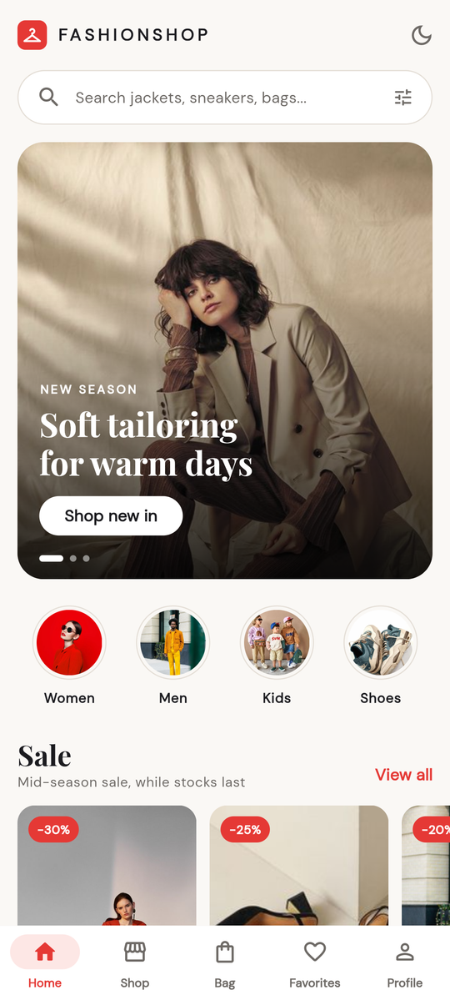
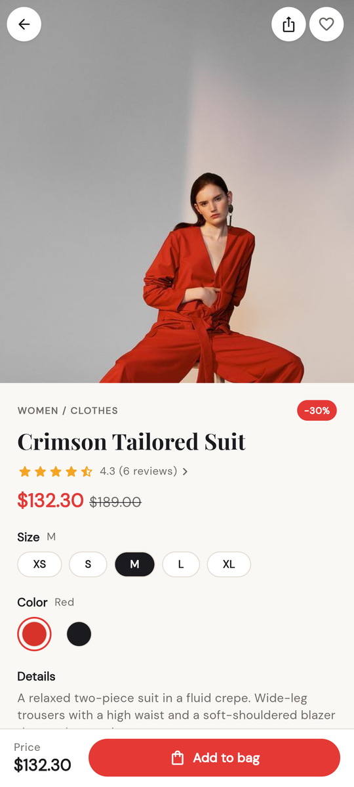
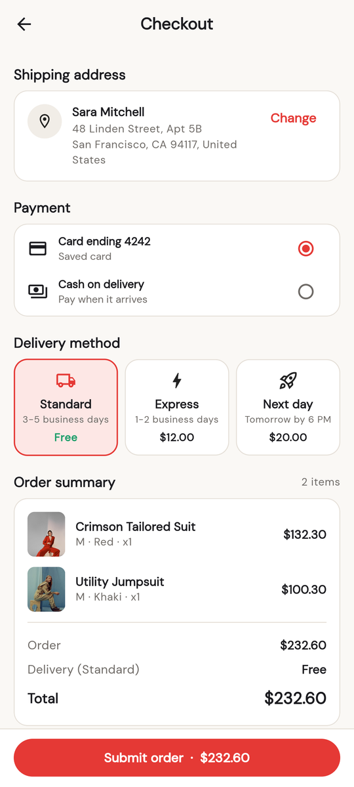
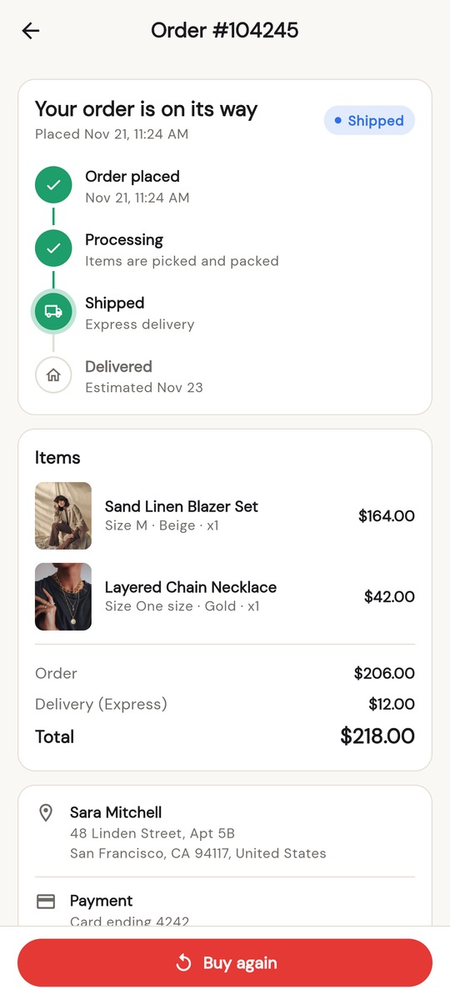
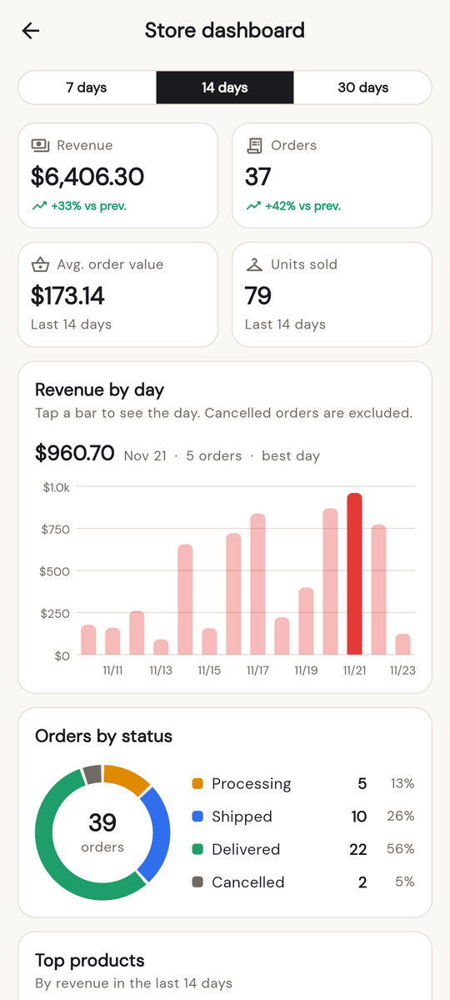

# Fashionshop

A fashion e-commerce app in Flutter with a Firebase backend: catalog, search and filters, favorites, bag, checkout, order tracking, and a sales dashboard for the store owner.

| Home | Product | Checkout | Order tracking | Owner dashboard |
|---|---|---|---|---|
|  |  |  |  |  |

## Features

- Browse Women, Men and Kids; home page with hero carousel and sale rail
- Search with filters (category, type, price range, size, rating, on sale) and six sort orders
- Product page with size and color pickers, ratings and reviews
- Favorites, bag with quantity steppers, checkout with saved addresses and delivery options
- Order history with a status timeline and "Buy again"
- Store dashboard: revenue by day, orders by status, average order value, top products
- Email, Google and Facebook sign-in (Firebase Auth)
- Light and dark themes, skeleton loading, empty and error states

## Architecture

```
screens / widgets  ->  cubits (flutter_bloc)  ->  StoreRepository / AuthRepository
                                                   |- Firestore + Firebase Auth + Storage
                                                   |- in-memory demo store
```

- `lib/core/theme/`: design tokens and Material 3 themes
- `lib/cubits/`: catalog, cart, favorites, orders
- `lib/data/`: repository interfaces, Firebase implementations, demo implementations
- `lib/presentation/`: screens and shared widgets

## Run it

```bash
flutter pub get

# Demo mode: no Firebase project needed, sample catalog and orders
flutter run -d chrome --dart-define=DEMO=true

# With your own Firebase project
flutterfire configure
flutter run
```

```bash
flutter test
```

## Status and credits

Started as a three-person final project for the Digital Egypt Pioneers Initiative (DEPI) with nourhan312 and Hend Sayed. The design system, search, order tracking, owner dashboard and repository layer were added later by Mohamed Sameeh.

Not included yet: a payment gateway (the card option is a label), push notifications, and an owner role for the dashboard.
